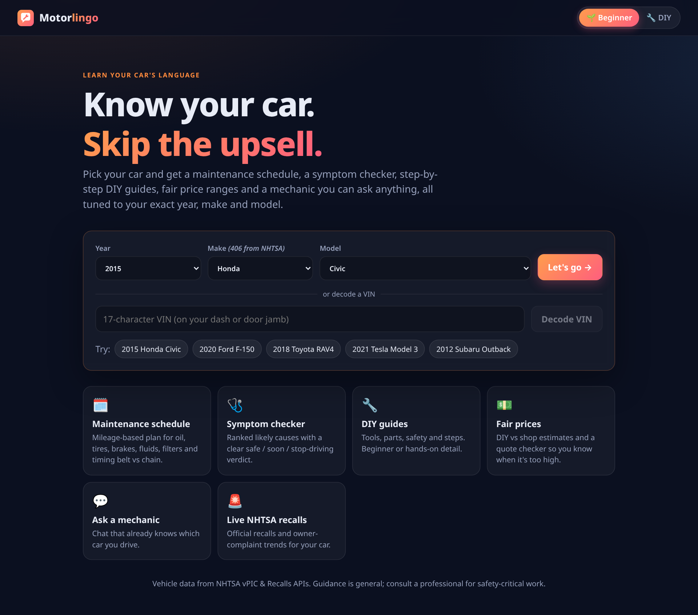
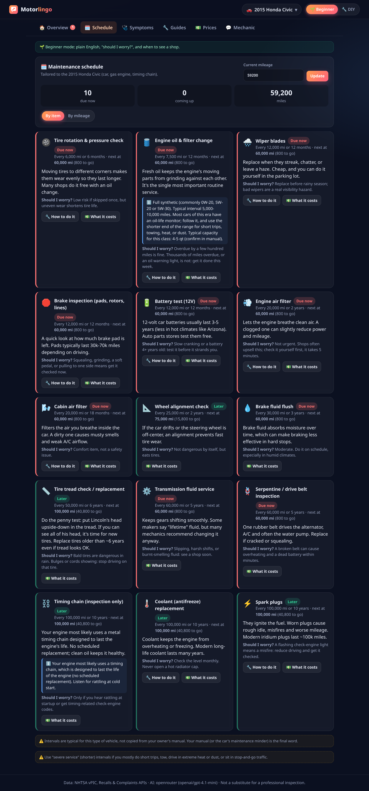
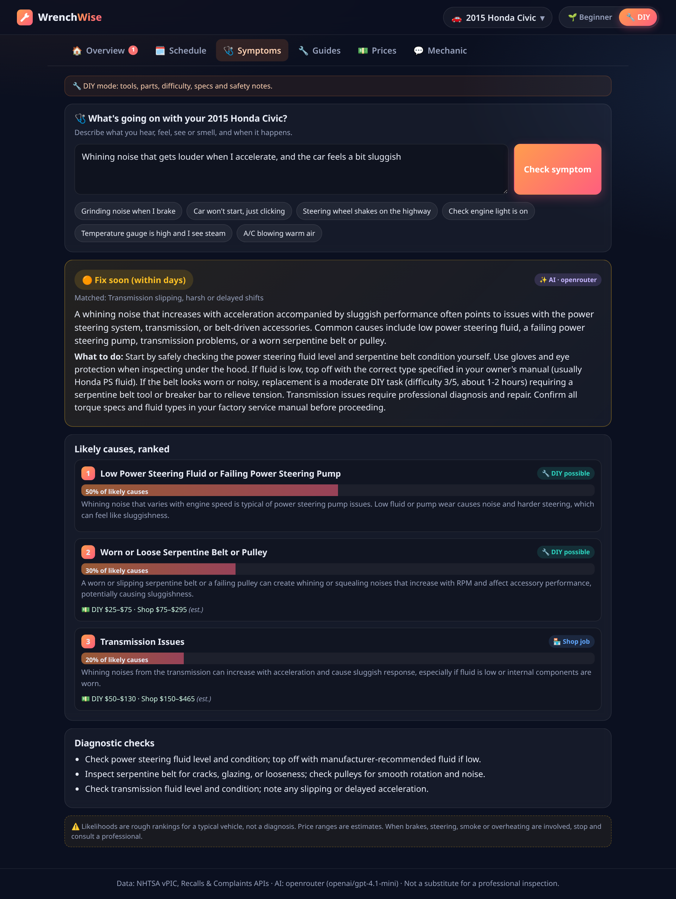
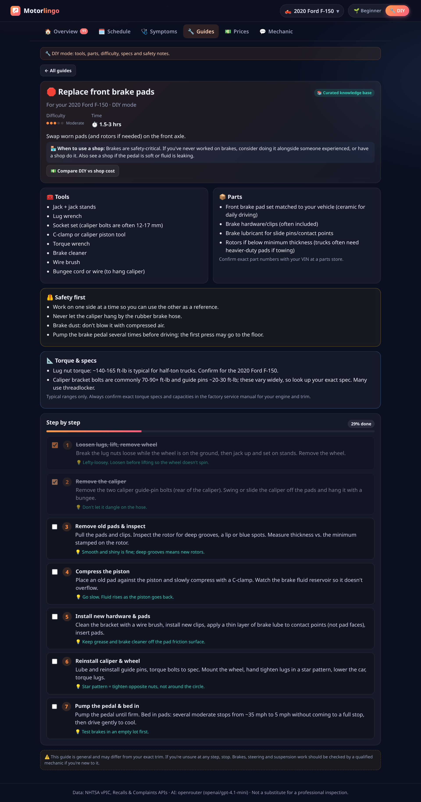
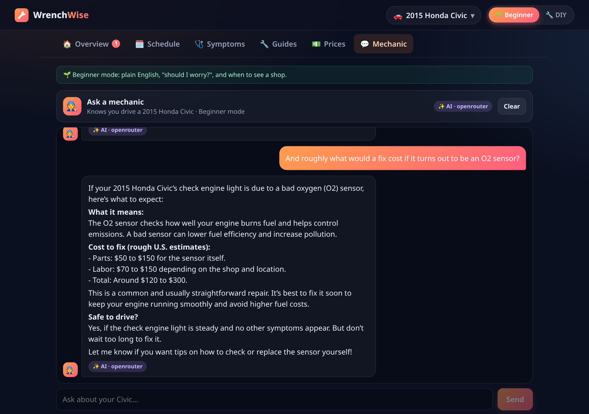
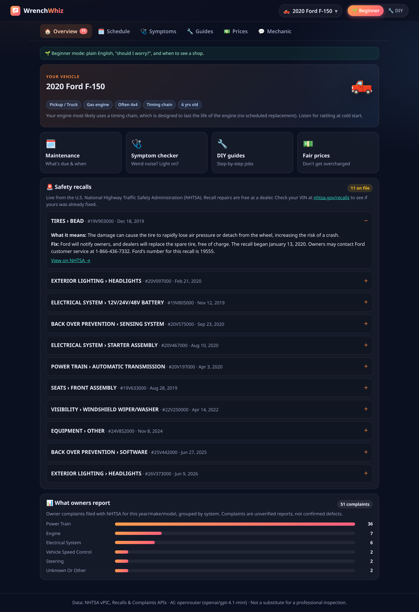
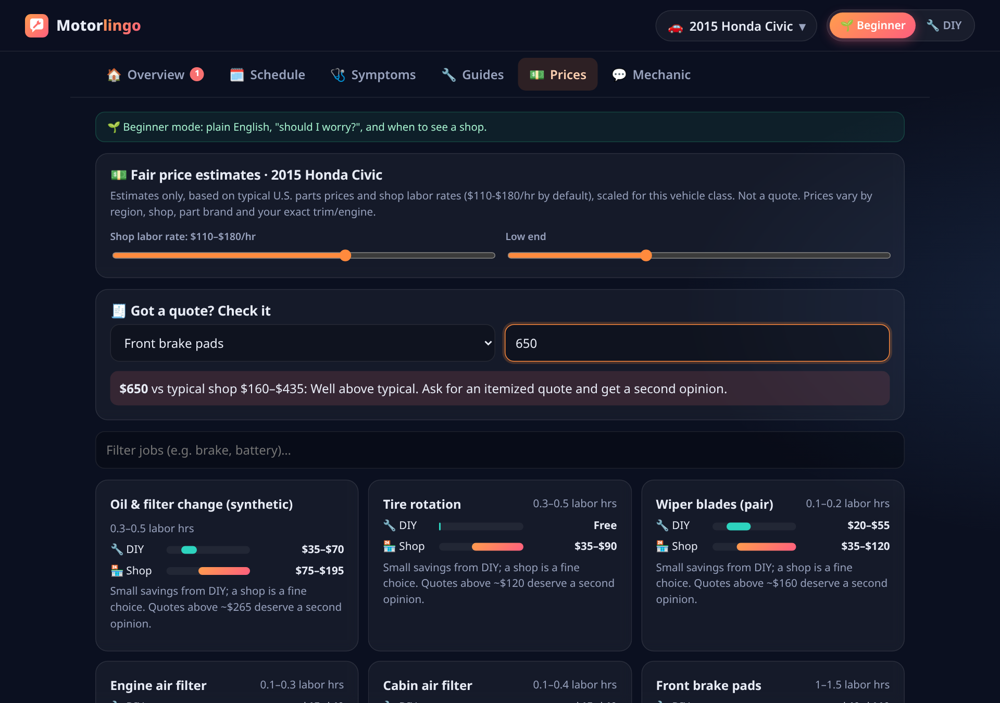
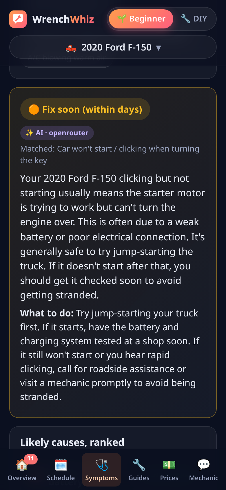
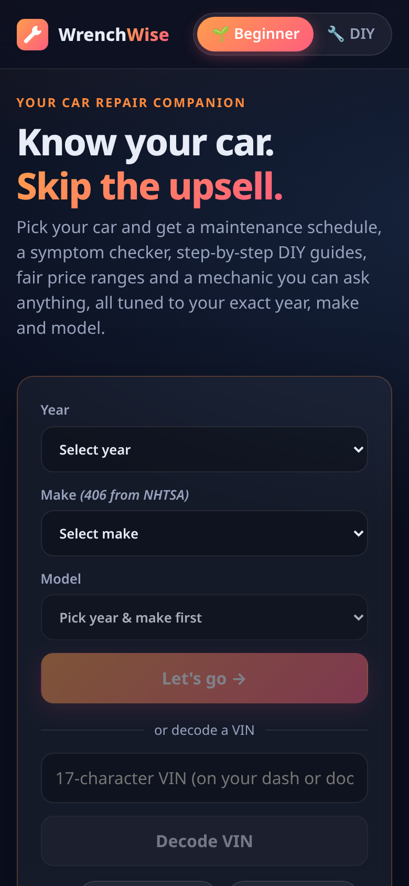

<div align="center">


# WrenchWise

**Know your car. Skip the upsell.**

A car repair companion for people who don't know much about cars, and for beginners who want to learn to fix their own.
Pick any year, make and model and get a maintenance schedule, a symptom checker, step-by-step DIY guides, fair price estimates, live safety recalls and an AI mechanic that already knows which car you drive.




</div>

## Why I built it

Most people who walk into a repair shop can't tell if a $650 brake quote is fair, if a noise means "stop driving now", or if they could do the job themselves in 20 minutes. WrenchWise turns public vehicle data and curated mechanic knowledge into plain-English answers for your exact car. It also helps you learn: a **DIY mode** switches every screen to tools, parts, specs and step-by-step instructions.

## Features

- 🚗 **Any vehicle:** 400+ makes and every model/year, live from NHTSA's vPIC database. Optional **VIN decode** fills in engine, trim and drive type.
- 🌱 / 🔧 **Beginner ↔ DIY mode:** one toggle changes every feature. Beginner mode gives plain English, "should I worry?" and when to see a shop. DIY mode gives tools, parts, difficulty, time, safety notes and torque/spec caveats.
- 🗓️ **Maintenance schedule** tailored to the car: oil interval by model year, **timing belt vs chain**, CVT fluid, AWD/4x4 fluids, EV- and hybrid-specific items. Enter your mileage to see what's due now, or switch to a by-mileage timeline.
- 🩺 **Symptom checker:** describe a noise, smell, light or feeling and get ranked likely causes, an urgency verdict (**safe to drive / fix soon / stop driving**), whether it's a DIY or shop job, and cost ranges.
- 📋 **Step-by-step DIY guides:** 10 curated guides (oil change, brake pads, battery, filters, wipers, tire rotation, coolant, spark plugs, headlights) with a progress checklist. AI can generate a guide for any other repair.
- 💵 **Fair price estimates:** DIY vs shop cost for 40 common jobs, scaled for vehicle class (luxury, truck, EV), with an adjustable labor-rate slider and a **quote checker** that flags quotes that are too high.
- 🚨 **Live safety recalls & owner complaints:** official NHTSA recalls (including "Park It" warnings) and a chart of the systems owners complain about most.
- 💬 **AI mechanic chat** that knows your car, mode, mileage and open recalls.
- 📱 **Mobile-first UI** with a bottom tab bar on phones.

## Screenshots

| Maintenance schedule | Symptom checker (AI) |
|---|---|
|  |  |
| **DIY guide (DIY mode)** | **AI mechanic chat** |
|  |  |
| **Recalls & owner complaints** | **Fair prices & quote checker** |
|  |  |

<p align="center"> </p>

More screenshots are in [`screenshots/`](screenshots/).

## Architecture

```
React (Vite) SPA  ──►  Express API  ──┬──►  NHTSA APIs (vPIC makes/models/VIN, Recalls, Complaints)  [cached 12h]
                                      ├──►  Curated knowledge base (server/kb/)
                                      │       profile → maintenance · symptoms · guides · prices
                                      └──►  Pluggable LLM layer (server/llm.js)
                                              OpenRouter  |  OpenAI  |  Anthropic   → falls back to the KB
```

- **Vehicle profile** (`server/kb/profile.js`): from year/make/model the server works out body type, EV/hybrid, luxury class, timing belt vs chain, likely CVT, AWD and a cost multiplier. Every feature adapts to this profile.
- **Knowledge base first, AI on top:** the app is fully usable with **no API key**. Schedules, prices, curated guides, symptom matching and rule-based chat all run offline. With a key, the AI adds free-text symptom analysis, generated guides for any repair and a conversational mechanic.
- **Pluggable LLM:** one shared OpenAI-compatible client (OpenRouter and OpenAI) plus Anthropic Messages, chosen by environment variables. Structured JSON output is used for symptoms and guides. Any AI error falls back to the knowledge base.
- **Safety guardrails:** the AI can never rate a symptom as less urgent than the curated knowledge base does (e.g. grinding brakes always means "stop driving"). Prompts forbid made-up recalls and exact torque specs, and every estimate and AI answer is labeled.

## Tech stack

| Layer | Tech |
|---|---|
| Frontend | React 19, Vite, hand-written responsive CSS (no UI framework) |
| Backend | Node.js 18+, Express 5 (serves the API and the built SPA) |
| Data | [NHTSA vPIC](https://vpic.nhtsa.dot.gov/api/), [NHTSA Recalls & Complaints](https://www.nhtsa.gov/nhtsa-datasets-and-apis) |
| AI | [OpenRouter](https://openrouter.ai) (default `openai/gpt-4.1-mini`), OpenAI, or Anthropic via `fetch` |
| Testing | End-to-end API smoke test (50 checks: 3 vehicles × 2 modes), Playwright screenshots |

## Run it locally

Requires **Node.js 18+**.

```bash
git clone https://github.com/namanagp/wrenchwise.git
cd wrenchwise
npm install
npm start        # builds the frontend and serves everything at http://localhost:5180
```

| Script | What it does |
|---|---|
| `npm start` | Build + serve on port 5180 (`PORT` to change) |
| `npm run dev` | Hot reload: Vite on :5173 (proxies `/api`) + API on :5180 |
| `npm test` | End-to-end API smoke test (server must be running) |
| `npm run screenshots` / `screenshots:ai` | Regenerate screenshots with Playwright |

## Environment variables (optional AI)

Copy `.env.example` to `.env` and set **one** key. Real environment variables override `.env`.

| Variable | Purpose | Default |
|---|---|---|
| `OPENROUTER_API_KEY` | Enables AI via OpenRouter (preferred when several keys are set) | none |
| `OPENROUTER_MODEL` | Any model ID from `https://openrouter.ai/api/v1/models` | `openai/gpt-4.1-mini` |
| `OPENROUTER_SITE_URL` / `OPENROUTER_APP_NAME` | Sent as `HTTP-Referer` / `X-Title` attribution headers | `http://localhost:5180` / `WrenchWise` |
| `OPENAI_API_KEY`, `OPENAI_MODEL`, `OPENAI_BASE_URL` | OpenAI or any OpenAI-compatible API | `gpt-4o-mini` |
| `ANTHROPIC_API_KEY`, `ANTHROPIC_MODEL` | Anthropic | `claude-haiku-4-5` |
| `LLM_PROVIDER` | Force `openrouter`, `openai` or `anthropic` | auto |
| `PORT` | Server port | `5180` |

| | Without a key | With a key |
|---|---|---|
| Vehicle data, VIN decode, recalls, complaints | ✅ live NHTSA | ✅ |
| Maintenance, prices, quote checker | ✅ knowledge base | ✅ |
| Symptom checker | ✅ 18 common symptoms | ✅ AI analysis of any description |
| DIY guides | ✅ 10 curated | ✅ plus AI-generated guides for any repair |
| Chat | ✅ rule-based answers | ✅ full conversational mechanic |

## Roadmap / v2

- 🧩 **Interactive car visuals:** a clickable diagram or 3D model of your vehicle that shows where parts are (battery, air filter, oil drain plug, brake calipers), highlighted while you follow a guide.
- 🛒 **Order the right part:** look up exact part numbers by VIN, compare prices across retailers, and add them to a cart alongside the matching guide.
- 🛠️ **Guided self-repair:** step-by-step mode with photos/video per step, a built-in torque and spec lookup, a tool checklist, and "stop and call a pro" checkpoints for safety-critical steps.
- 📒 **Service history & reminders:** log completed jobs and get notified when the next item is due.
- 🔌 **OBD-II integration:** read live trouble codes from a Bluetooth adapter and feed them to the symptom checker.
- 🗺️ **Local shop finder** with real labor rates to make price estimates sharper.

## Limitations & disclaimer

- Intervals, specs and prices are **typical ranges for the vehicle class**, not copied from each manufacturer's service manual. The owner's manual is the final word.
- Timing belt/chain and CVT detection uses a rules table for popular models. AI answers can be wrong, and the app labels them clearly.
- Some trim-specific model names may not match NHTSA's recall data. Check your VIN at [nhtsa.gov/recalls](https://www.nhtsa.gov/recalls).

> ⚠️ **WrenchWise gives general guidance, not a professional inspection.** For brakes, steering, suspension, tires, fuel systems, airbags and high-voltage EV components, consult a qualified mechanic. Use at your own risk.

## License

[MIT](LICENSE) © 2026 Naman Gupta
